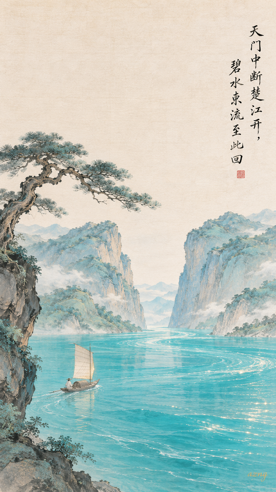
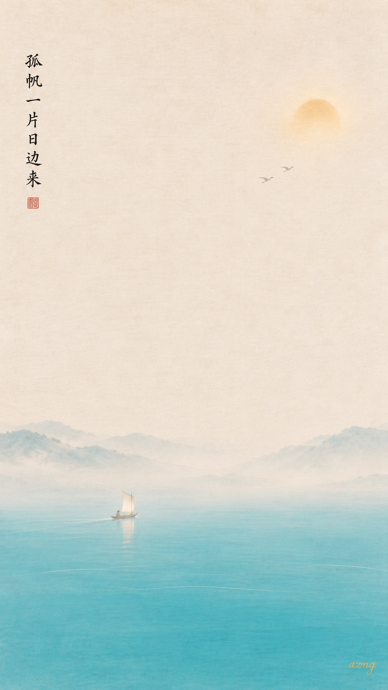
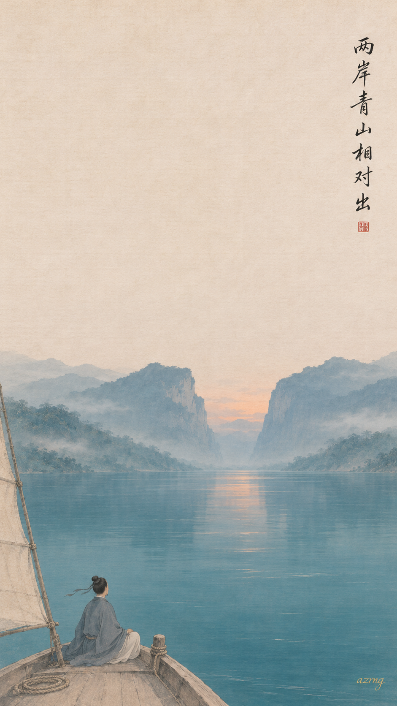
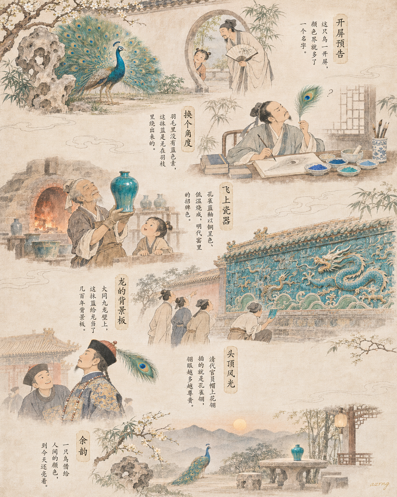
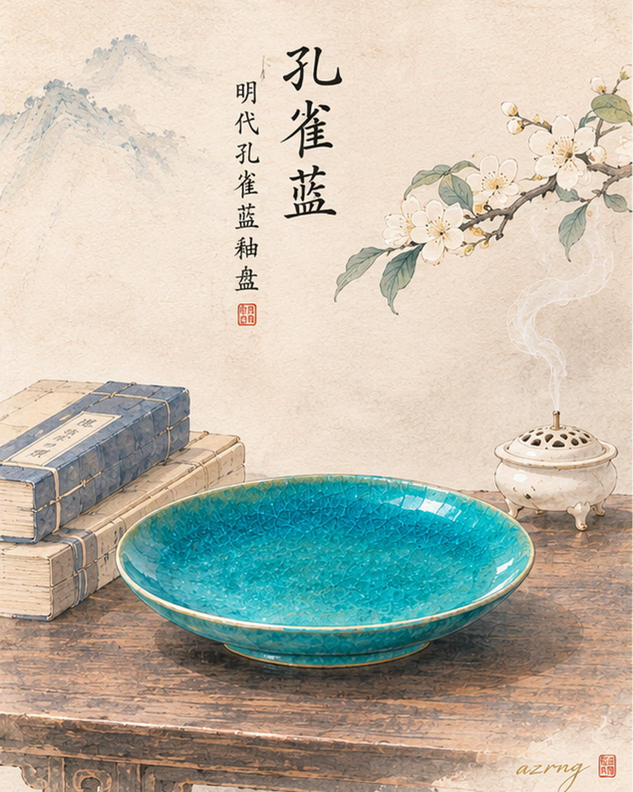
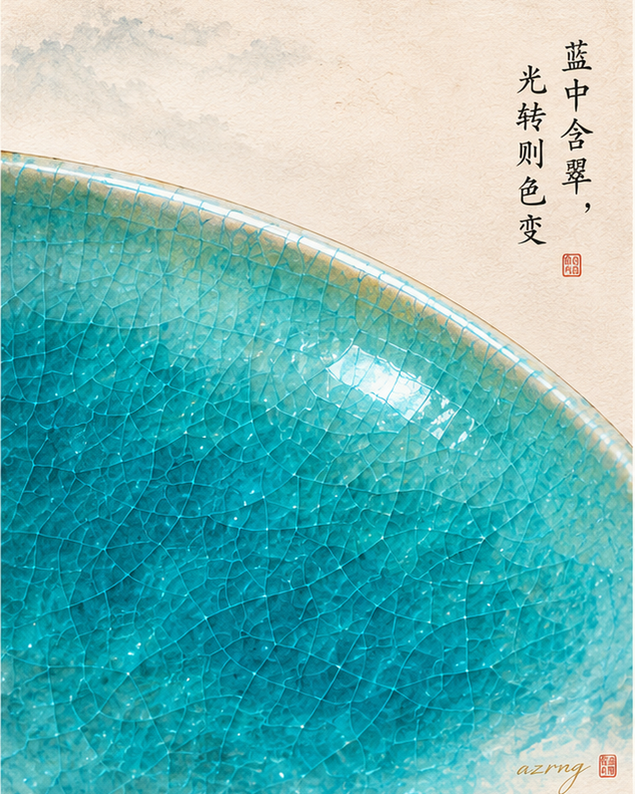
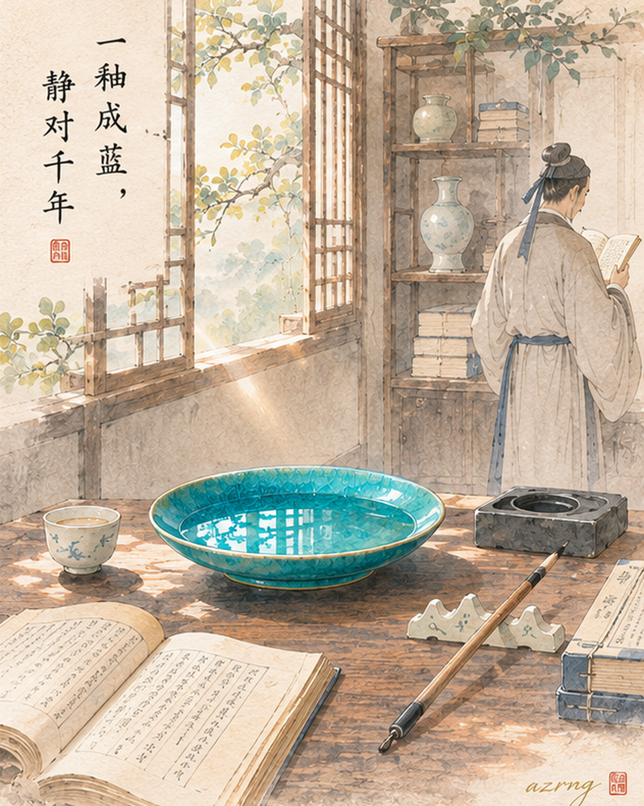

## 一色一诗

### 标题

孔雀蓝 ×《望天门山》｜碧水东流至此回

### 正文

如果《望天山门》有颜色，我想是那一江孔雀蓝。

如果李白笔下的江水有颜色，我想是那一江孔雀蓝。它介于青与碧之间，比月白浓郁，比石青明亮，像正午的日光沉进江心，亮而不艳，清而不寒。

"碧水东流至此回"，千年前的楚江，大约就是这个颜色。两山对峙处，水色回旋，一叶孤帆自日边而来。

三张壁纸，三种诗境：图一画完整山川，碧水奔来、青山相对；图二只取一片孤帆，愈简愈远；图三换作暮色回望，山已过，江声犹在。

三张里，你更喜欢哪一种诗境？下一期想看哪一种传统色？

\#中国传统色 #孔雀蓝 #望天门山 #李白 #古诗词 #国风壁纸 #东方美学 #手机壁纸

## 一色一源

### 标题

中国传统色｜孔雀蓝，是孔雀借给瓷器的颜色

### 正文

古代颜色命名界，偶尔也走"直白风"——像孔雀，就叫孔雀蓝。

别嫌名字直白，这抹介于蓝与绿之间的颜色，来历相当能打：它长在孔雀的颈羽上，被工匠搬进窑火，烧成了著名的孔雀蓝釉；又爬上琉璃影壁，在九龙壁给龙配了几百年戏；到了清代，干脆插上官员帽顶，成了身份的门面。

一只鸟，从羽毛一路参与瓷器、建筑、服饰美学建设，业务范围横跨多个朝代。

冷知识：孔雀羽毛里其实没有蓝色色素，那抹蓝是光在羽毛微观结构里"绕路"绕出来的——所以换个角度看，颜色还会偷偷变。

（不同图谱里的孔雀蓝深浅略有差异，大致都在蓝与绿之间那一段。）

如果让你给这抹蓝重新取个名字，你会叫它什么？

\#中国传统色 #孔雀蓝 #国风插画 #东方美学 #传统色图鉴 #古人生活美学 #瓷器之美 #水墨插画

## 一色一物

### 标题

中国传统色｜孔雀蓝，一只明代瓷盘上的孔雀翎

### 正文

有些蓝，不肯安分地做蓝。

孔雀蓝就是这样，蓝里带绿，绿里又含着水光，像孔雀翎羽在阳光下轻轻转了一个角度。

它最初的釉色来自西亚，沿着海上贸易传入中国，宋金时期北方窑场开始烧造；到明代景德镇御窑，这种釉才真正烧出名堂——宣德时已颇精美，正德一朝发色最为纯正。

这种釉以铜呈色，低温烧成。釉面清透如玻璃，布满细碎的鱼子纹开片；釉厚处蓝得像深海，釉薄处又淡成一汪春水。同一件器物，随着光线流转，蓝与绿悄悄换位。

所以孔雀蓝从来不是色卡上固定的一格，它是火、釉与光共同完成的一次呼吸。

下一期，你想看哪一种颜色藏在哪件古物里？

\#中国传统色 #一色一物 #孔雀蓝 #中国美学 #东方美学 #颜色釉 #明代瓷器 #文物
