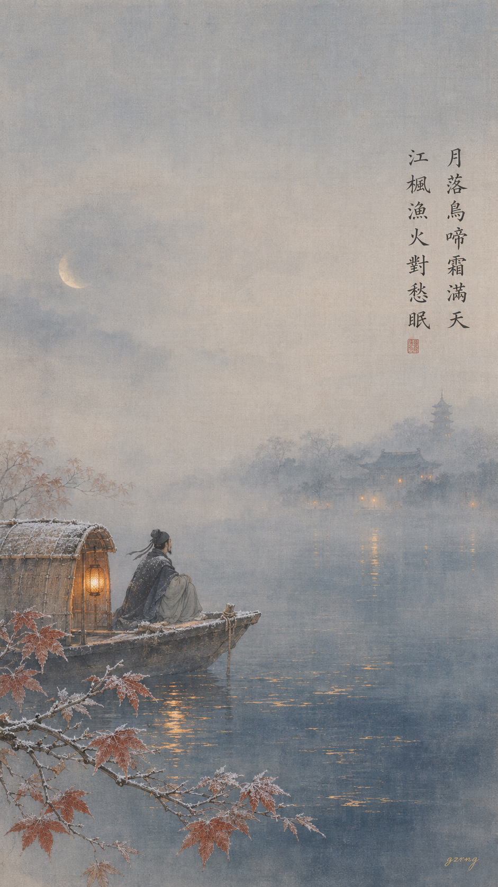
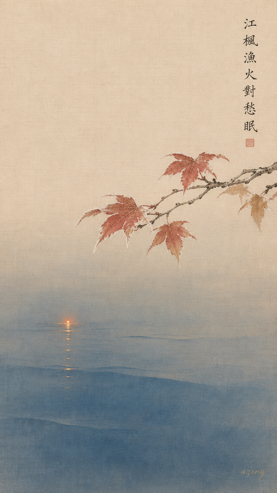
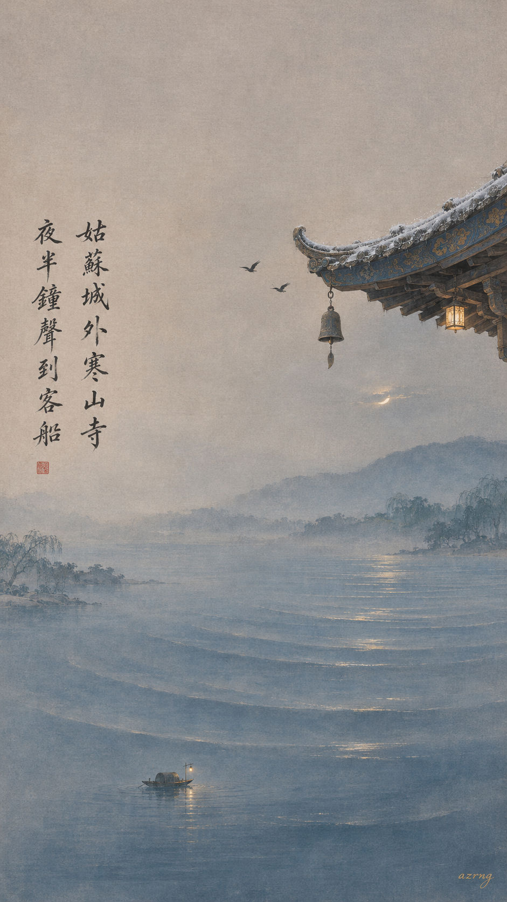
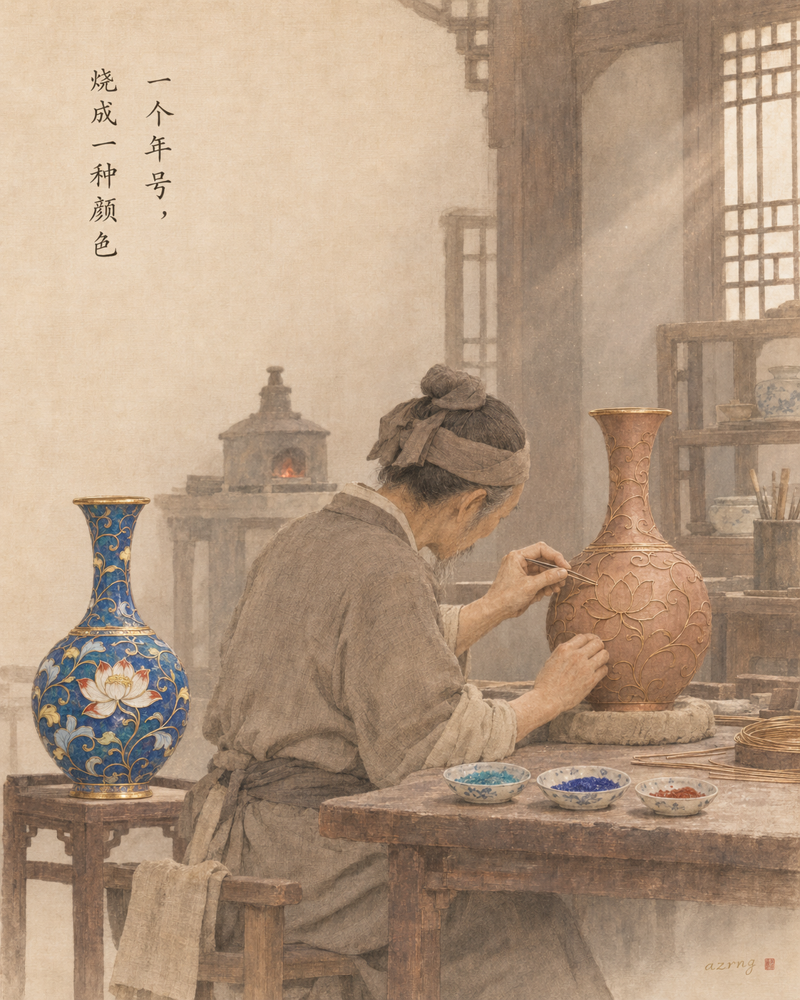
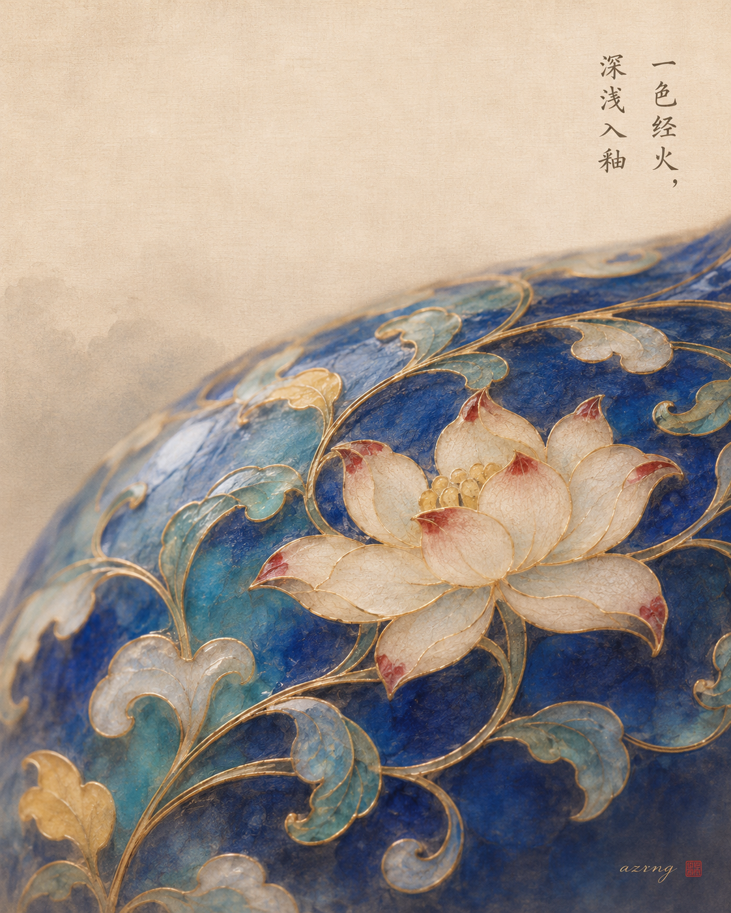

## 一色一诗

### 标题
中国传统色｜景泰蓝落进〈枫桥夜泊〉

### 正文
如果《枫桥夜泊》有颜色，我想应该是景泰蓝。

不是漆黑的夜。是月落之后、霜满江天之前，姑苏城外最安静的那一层蓝——深而不暗，亮而不浮。

景泰蓝取自明代景泰年间铜胎掐丝珐琅的釉色，因初创时以蓝釉为主而得名，蓝得纯正浓郁，又带着釉面的温润光泽。用它来盛张继那一夜的江天，正合适：深蓝的水色里沉着一点渔火，像珐琅器上鎏金的微光，清冷里透着暖意，愁而不惨。

三张壁纸：图一画姑苏城外完整的夜泊，客船独系，寒山寺淡在雾蓝深处；图二只留一枝江枫、一点渔火，把夜色铺得最满；图三换到钟声里，让一圈圈涟漪替夜半的钟声走完全程。

三张里，你更想泊在哪一种夜色里？

\#中国传统色 \#景泰蓝 \#枫桥夜泊 \#张继 \#古诗词 \#国风壁纸 \#东方美学 \#手机壁纸

## 一色一源

### 标题
中国传统色｜“景泰蓝”的蓝，是跟一个年号借的

### 正文
古人给颜色取名，多半向自然伸手：天青、月白、藕荷……今天这抹蓝是例外——名字借自一件器物、一个年号。

景泰蓝原本是工艺之名，指铜胎掐丝珐琅：铜丝在铜胎上掐出花纹，填釉入炉烧造，磨光镀金。因存世器物多有“景泰年制”款，这门手艺便得了此名；而“景泰蓝”三个字，最早见于清雍正年间的造办处档案。这门手艺一般认为元代前后由阿拉伯地区传入中国，落地生根，成了地道的国粹。

有趣的是，景泰帝朱祁钰在位七年、内忧外患，最后连皇位都没保住——但他的年号，却因为这抹宝石般的蓝，被后世叫了五百多年。

更妙的是，景泰蓝刚出炉时几乎发黑，冷却后蓝色才慢慢浮现，是真正从火里“淬”出来的颜色。据记载，乾隆的除夕年夜饭上，只有皇帝一人用景泰蓝餐具。

第一眼看到这抹蓝，你想到的是宝石，还是炉火？

\#中国传统色 \#景泰蓝 \#非遗传承 \#东方美学 \#国风插画 \#颜色科普 \#古人的审美

## 一色一物

### 标题
中国传统色｜景泰蓝，一个年号烧成的蓝

### 正文
大多数中国传统色取自山川草木，而景泰蓝，生在炉火里。

它的名字不来自染缸，也不来自矿脉，而来自一件器物——铜胎掐丝珐琅。这门工艺元代自阿拉伯地区传入中国，因存世器物多带“景泰年制”的款识，那一炉以蓝为基调的釉色，从此有了名字。

细看一只珐琅瓶：铜胎为骨，细铜丝掐出缠枝莲的轮廓，丝内填入蓝釉，入炉烧熔，再经磨光、镀金而成。同是一片蓝，釉厚处沉如深海，釉薄处透亮偏青，光线流转间，深浅冷暖全在一只瓶上。

在传统色名里，像这样“以物名色”的，景泰蓝几乎是独一份。一个年号，一炉火，一种蓝，连在一起，烧了五百多年。

下一期，你想看哪一种颜色藏在哪件古物里？

\#中国传统色 \#一色一物 \#景泰蓝 \#掐丝珐琅 \#东方美学 \#文物 \#传统工艺 \#非遗

## 参考资料

本文色值与史实依据以下来源核对：

1. [中国色（zhongguose.com）· 景泰蓝 #2775B6](https://zhongguose.com/)
2. [故宫博物院《故宫藏金属胎掐丝珐琅器辨赏》](https://www.dpm.org.cn/Uploads/wenhua/E32/E32d.htm)
3. [人民网-国家人文历史《流光溢彩自相依 景泰蓝：方寸间的贵族工艺》](https://www.ihchina.cn/project_details/9512.html)
4. [光明日报《【中国好手艺91】景泰蓝》（国家级非遗代表性传承人钟连盛口述）](https://epaper.gmw.cn/gmrb/html/2023-11/05/nw.D110000gmrb_20231105_5-01.htm)
5. [台北故宫博物院南部院区「谜样景泰蓝」展览](https://south.npm.gov.tw/ExhibitionsDetailC003110.aspx?Cond=e688e65a-4832-4c2a-9fa8-ef106e8f3ec0&appname=Exhibition3111)
6. [人民日报海外版《景泰蓝，皇家重器之光》](http://paper.people.com.cn/rmrbhwb/html/2016-12/10/content_1734491.htm)
7. [古诗文网《枫桥夜泊》原文与注释](https://www.gushiwen.cn/mingju/juv_5825ef91e09b.aspx)
