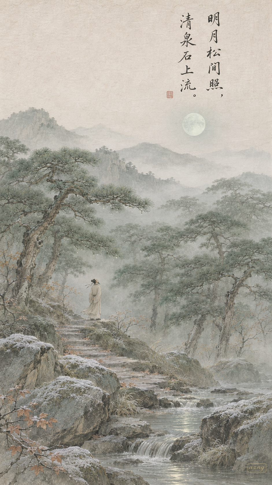
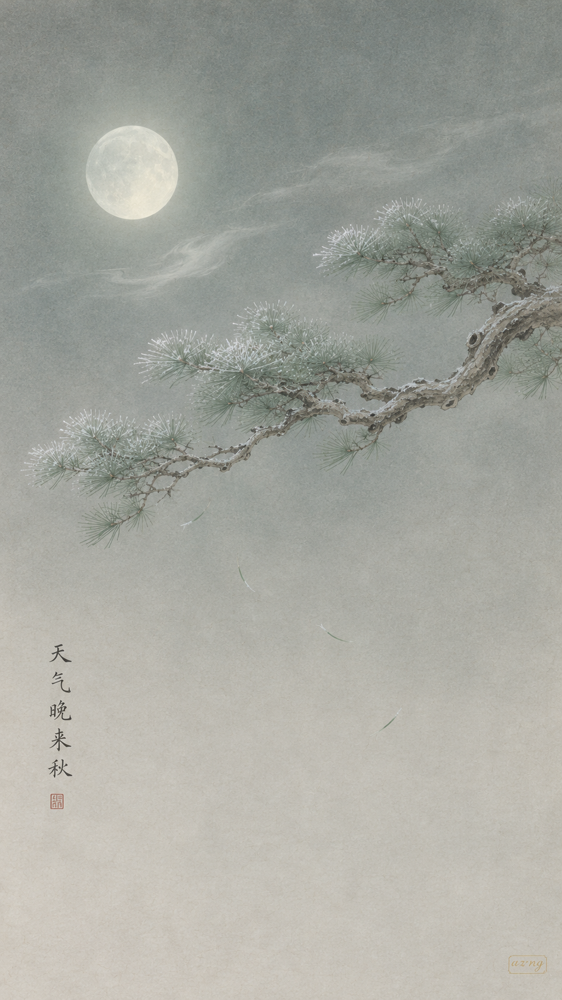
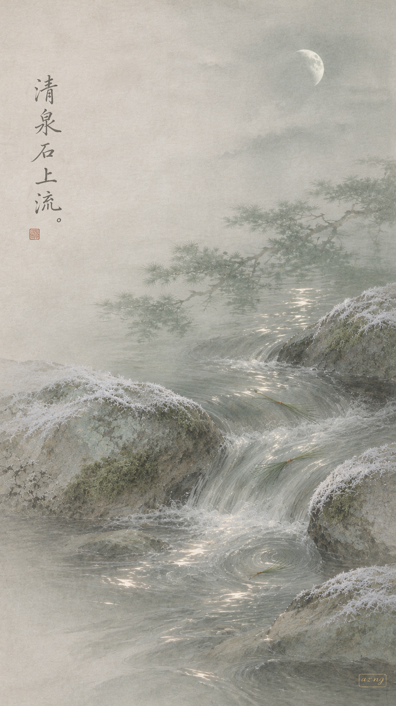
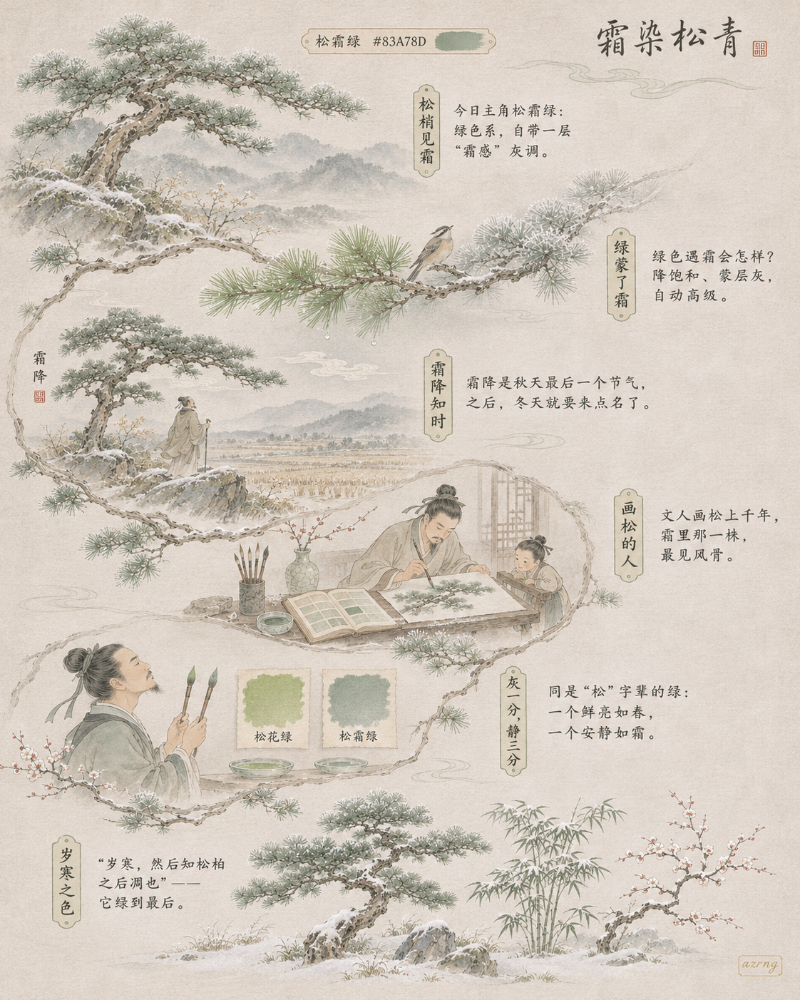
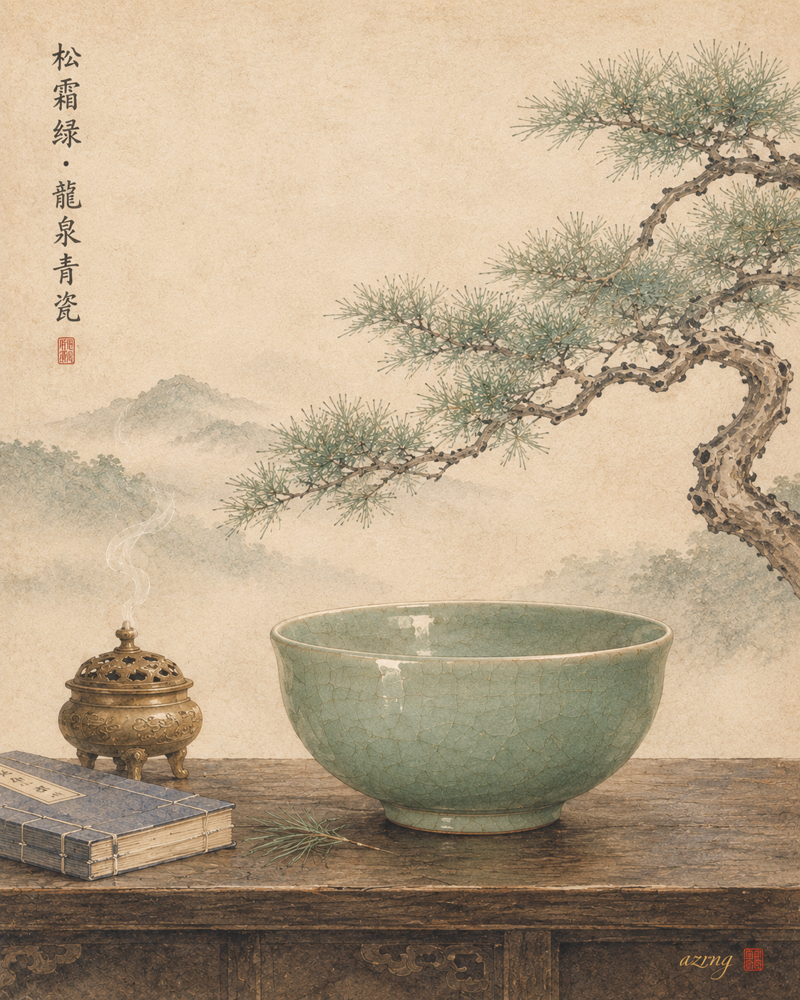
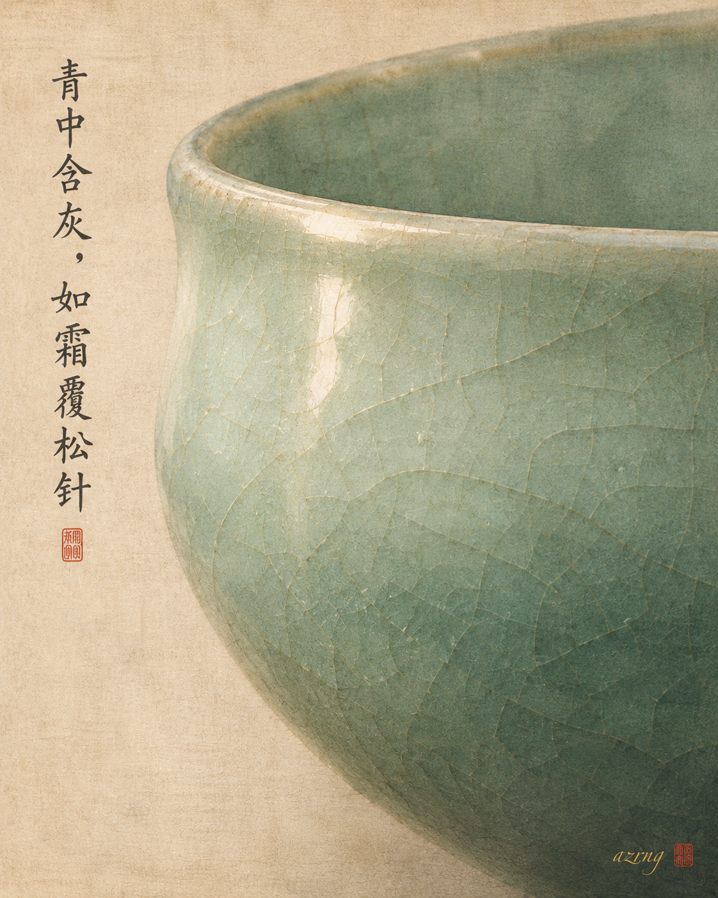
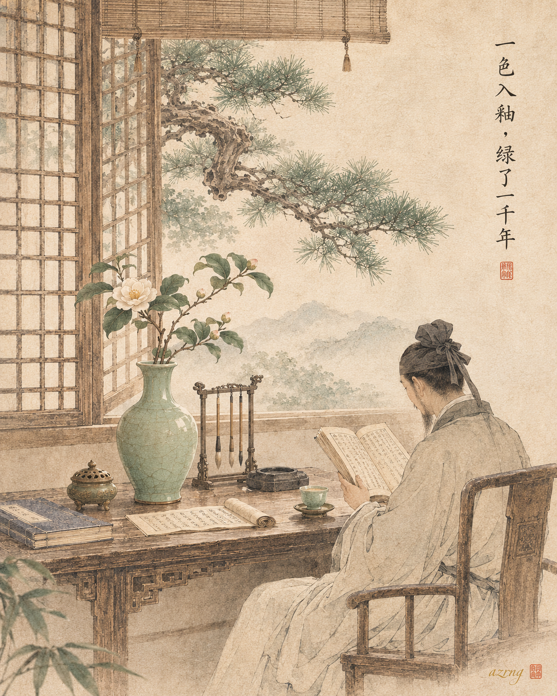

## 一色一诗

### 标题

中国传统色｜松霜绿落进王维的《山居秋暝》

### 正文

如果《山居秋暝》真的有颜色，我想应该就是松霜绿——一场新雨刚过，暮色沉进松林，霜色轻轻覆上松针的那种绿。

它不是春草的鲜嫩，也不是盛夏浓荫的厚重。松霜绿安静、清润，带着晚秋山中的凉意，却并不荒凉。王维写“空山新雨后，天气晚来秋”，写“明月松间照，清泉石上流”，那种被雨水洗净、被月光照透的山林气息，恰好就是这个颜色。

三张壁纸，画了三种松间：
图一，是雨后空山、明月照松的完整诗境；
图二，是月光落在松枝上的一瞬；
图三，把视线交给石上清泉，让情绪顺着水声流远。

三张里，你更喜欢哪一种松间月色？

\#中国传统色 \#古诗词 \#国风壁纸 \#手机壁纸 \#东方美学 \#王维 \#山居秋暝 \#松霜绿

## 一色一源

### 标题

中国传统色｜松霜绿，是秋天留给冬天的颜色

### 正文

有一种绿，不是春天长出来的，是霜“降”下来的。

在现代整理的中国传统色体系里，松霜绿属于绿色系，色值 #83A78D——绿色里掺了一层灰，像清晨松针上那层薄薄的白霜。

绿色明明是春天的主场，古人偏偏记住了松树上最冷的那一抹。霜降之后，别的叶子忙着变黄脱落，松针还绿着，只是被霜蒙了一层灰调——鲜艳打了折，风骨却更清楚了。

《论语》里说：“岁寒，然后知松柏之后凋也。”天冷了，才知道谁是最后凋零的那一个。松霜绿大概就是这句话的颜色版：不争艳，只管安静地绿到最后。

如果让你给这个颜色重新取个名字，你会叫它什么？

\#中国传统色 \#松霜绿 \#东方美学 \#国风插画 \#传统色卡 \#二十四节气 \#岁寒三友 \#水墨插画

## 一色一物

### 标题

中国传统色｜松霜绿，藏在一只龙泉青瓷里

### 正文

有一种绿，从不急着争春。
像霜落松针，绿意里裹着一层清冷的灰。

松霜绿之名，取自司马光的诗句——“泉烛千年碧，霜松数寸青”。泉是千年的泉，松是经霜的松，古人笔下的绿，总带着时间。

要看懂这种颜色，我想请你去看龙泉窑的粉青釉。宋人把釉水一遍遍罩上坯体，烧出的绿不艳不躁，青中含灰，温润如玉——那份沉静的灰绿，与今天所说的松霜绿十分接近。

釉厚处深，釉薄处浅，光一斜过来，一只碗里的绿就有千百种层次。

松霜绿从来不是色卡上孤零零的一块。它曾在宋人的案头盛茶插花，安静地绿了一千年。

下一期，你想看哪一种颜色，藏在哪件古物里？

\#中国传统色 \#一色一物 \#松霜绿 \#龙泉青瓷 \#东方美学 \#宋代美学 \#文物 \#中国传统美学

## 参考资料

本文色值与史实依据以下来源核对：

1. [中国色（zhongguose.com）· 松霜绿 #83A78D](https://zhongguose.com/)
2. [古诗文网《山居秋暝》原文、译文与赏析](https://www.gushiwen.cn/shiwenv.aspx?id=44ba4afb80db)
3. [古诗文网名句页（「空山新雨后」句）](https://www.gushiwen.cn/mingju/juv_e3eb683f18f1.aspx)
4. [教育部《成语典》「歲寒松柏」条](https://dict.idioms.moe.edu.tw/idiomView.jsp?ID=8624&la=0&webMd=2)
5. [维基文库《温国文正司马公文集（四部丛刊本）·卷第十》](https://zh.wikisource.org/zh-hans/%E6%BA%AB%E5%9C%8B%E6%96%87%E6%AD%A3%E5%8F%B8%E9%A6%AC%E5%85%AC%E6%96%87%E9%9B%86_(%E5%9B%9B%E9%83%A8%E5%8F%A2%E5%88%8A%E6%9C%AC)/%E5%8D%B7%E7%AC%AC%E5%8D%81)
6. [识典古籍《温国文正司马公文集》目录（卷第十·律诗五「致政邵少卿挽辞」）](https://www.shidianguji.com/book/SBCK195/chapter/SBCK195_3)
7. [三联中读·秦大树《龙泉窑｜"梅子青"是怎么烧出来的？》](http://mdev.lifeweek.com.cn/h5/article/detail?artId=76482)
8. [故宫博物院院刊《龙泉窑厚釉技术和粉青釉瓷器的烧造》](https://www.dpm.org.cn/Uploads/File/2020/05/28/u5ecf78bf84969.pdf)
9. [澎湃新闻·沈岳明《龙泉窑厚釉技术和粉青釉瓷器的烧造始于何时？》](https://www.thepaper.cn/newsDetail_forward_7510304)
10. [中国非物质文化遗产网·龙泉青瓷烧制技艺](https://www.ihchina.cn/project_details/14272.html)
11. [中国非物质文化遗产网《略谈南宋龙泉青瓷的艺术成就和收藏价值》](https://www.ihchina.cn/news_1_details/10943.html)
