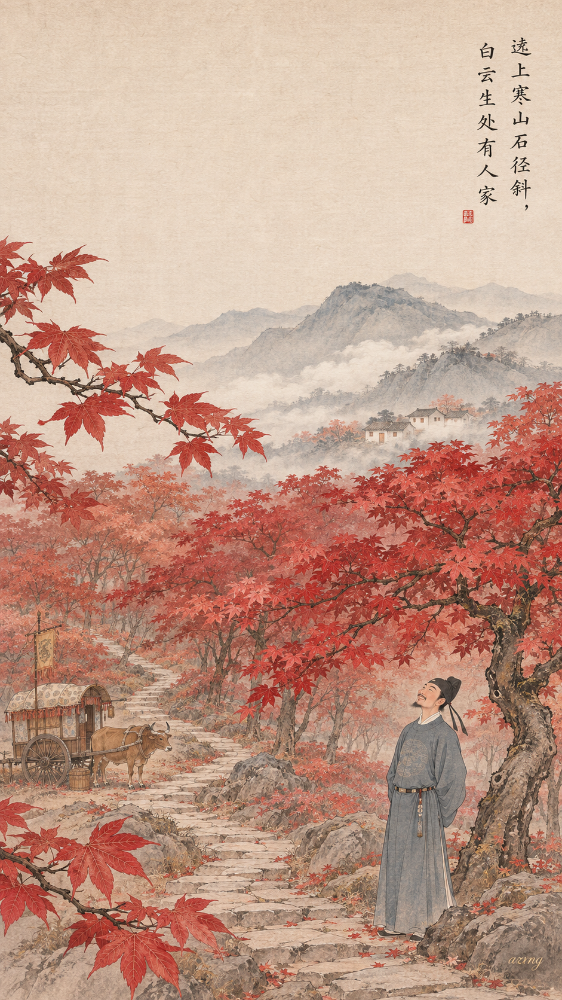
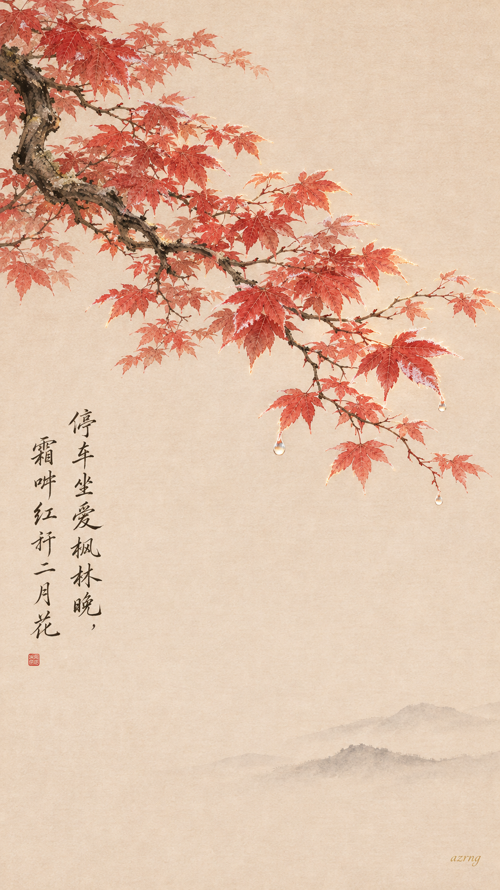
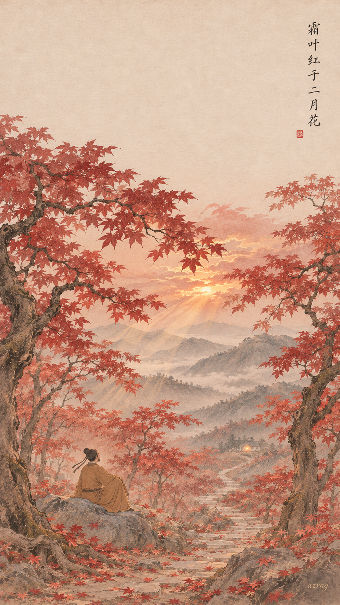
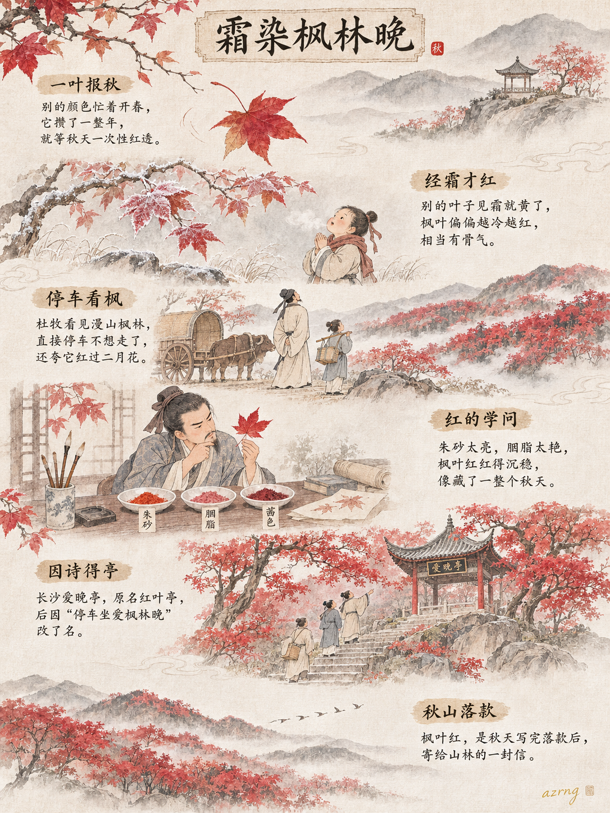
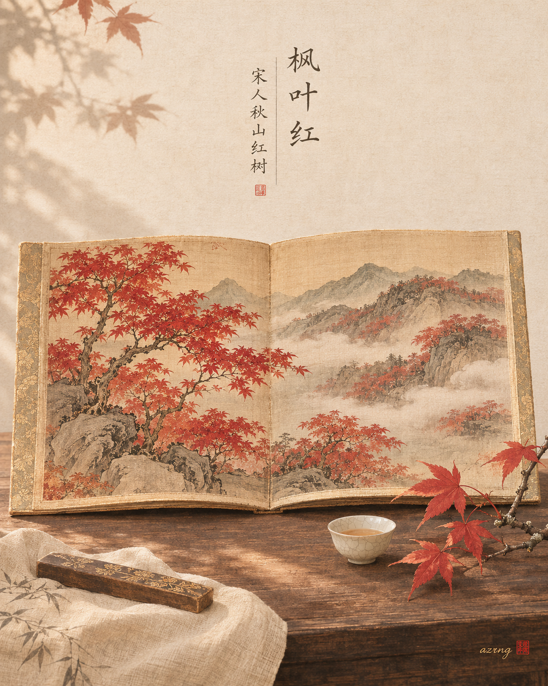
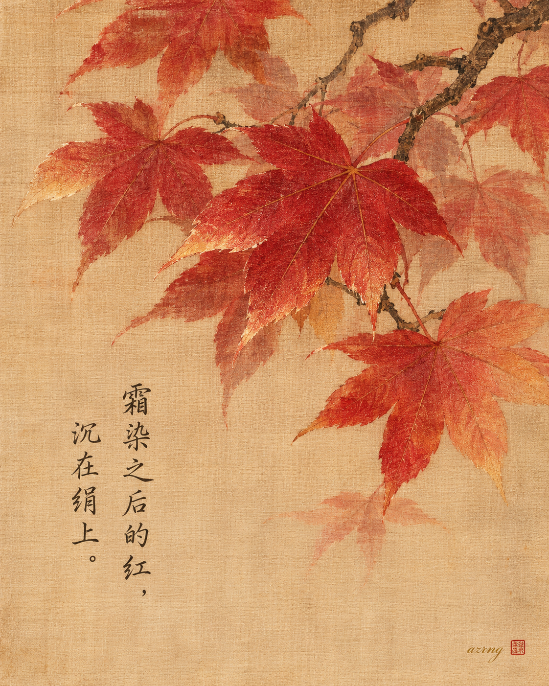
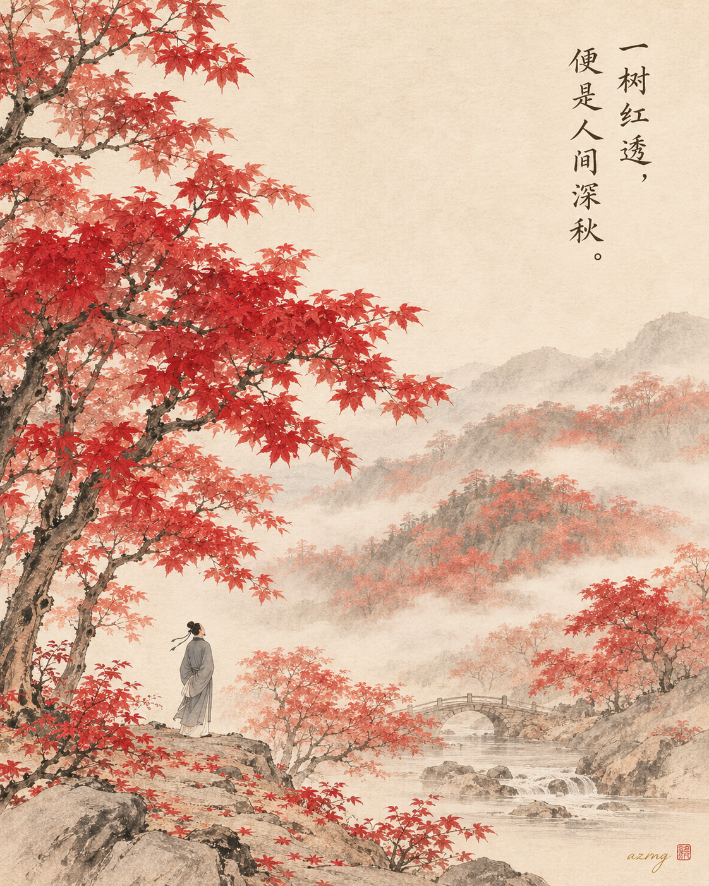

## 一色一诗

### 标题

中国传统色｜枫叶红 ×《山行》｜霜叶红于二月花

### 正文

深秋最浓烈的一笔，是枫叶红。

枫叶红，取自经霜的枫叶，红得沉稳，也红得坦荡。杜牧在《山行》里写“霜叶红于二月花”——春花娇嫩，霜叶却是在寒意里烧出来的红，愈冷愈艳，愈晚愈明。这一色一诗，正是深秋最好的注脚。

三张壁纸，三种秋意：

图一还原山行诗境，寒山石径、白云人家，与那一驾停驻的牛车；
图二只取一枝霜叶，工笔细描，红得安静；
图三走进枫林深处，晚霞漫山，坐看层林尽染。

三张里，你更喜欢哪一种秋色？

下一期，想看哪一种中国传统色？

\#中国传统色 #古诗词 #国风壁纸 #东方美学 #手机壁纸 #枫叶红 #杜牧 #山行

## 一色一源

### 标题

中国传统色｜枫叶红，凭什么“红过二月花”？

### 正文

在所有红色里，枫叶红大概是最能忍的一个。

整个春夏它都绿着，不跟百花抢镜，直到霜降一过、天气越冷，才把满树的红一次性烧起来。所以杜牧当年直接停车不走了，还留下那句“霜叶红于二月花”——秋叶硬是压了春花一头。

在现代整理的中国传统色体系里，“枫叶红”大约对应一种深沉饱满的红：比朱砂多了几分沉稳，比胭脂少了点艳气，红里带一点秋意的凉，是山野里特有的那种颜色。

更妙的是，长沙岳麓山的“爱晚亭”，原名红叶亭，后来干脆因为这句诗改了名。一片枫叶，愣是给一座亭子改了名字。

你觉得，秋天的枫叶红和春天的花红，哪个更胜一筹？

\#中国传统色 #枫叶红 #东方美学 #国风插画 #秋日氛围感 #传统色卡 #古人的浪漫 #水彩手绘

## 一色一物

### 标题

中国传统色｜枫叶红，藏在宋人的秋山里

### 正文

有些红，不属于春天，要等一场霜。

枫叶红就是这样的颜色。在今天的传统色谱里，它是 #C21F30 这样一块沉着又明艳的红；而在千年前，它落在绢上——宋人画秋景，霜后的红叶，是永恒的主角。

这一期去看一帧宋人绢本秋景小画：秋山淡淡，几树红叶经霜红透，远岫只留一痕灰青。千年过去，绢面泛出旧的暖黄，那几抹朱红却依然醒目。

古人画红叶，多用朱砂一类的矿物颜料：矿石研细，调胶敷色，沉着、透亮、久不褪去。旧绢的米黄衬着这抹红，反而比春花更亮，像霜后晴日里真正的枫叶。

所以枫叶红从来不是色卡上一块孤单的红——它被霜染过，被绢记住，被一代代人收藏在秋天的画意里。

下一期，你想看哪一种颜色，藏在哪件古物里？

\#中国传统色 #一色一物 #枫叶红 #东方美学 #宋代绘画 #古画之美 #中国美学 #秋天的颜色

