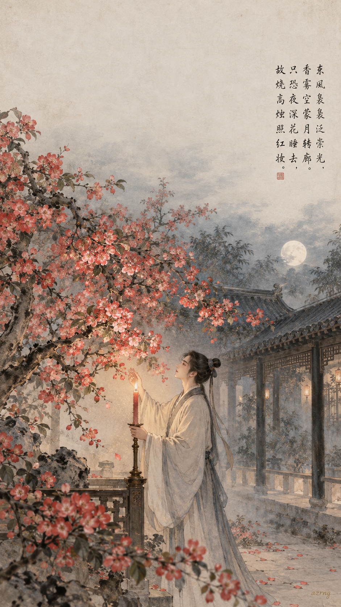
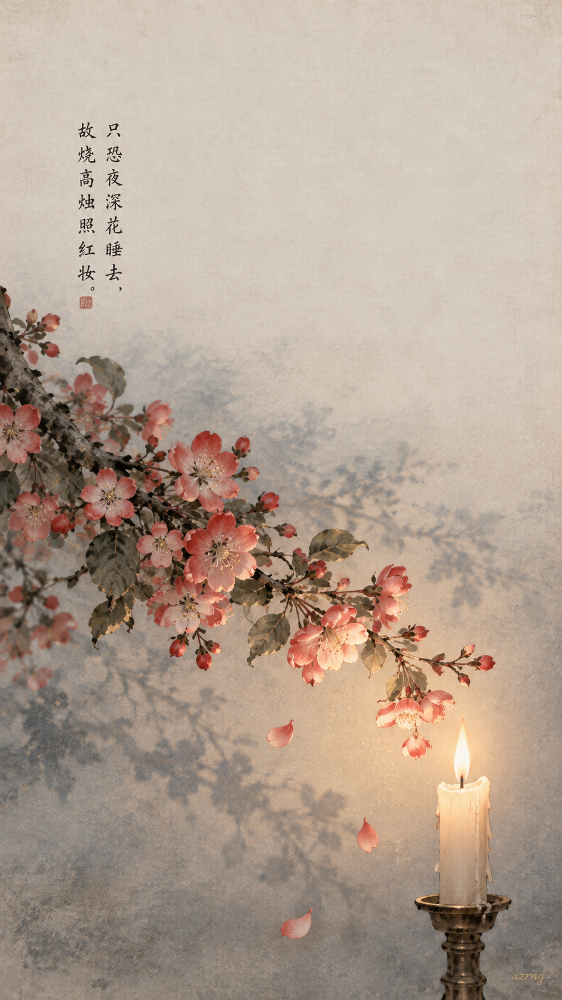
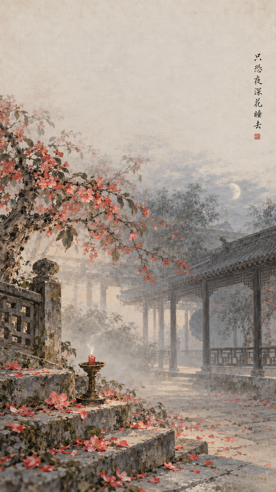
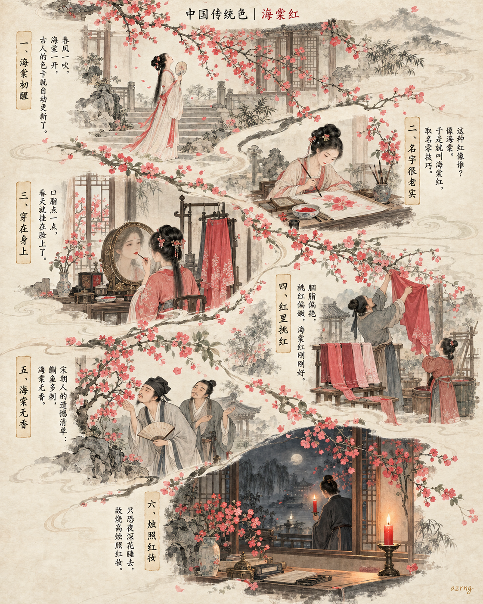
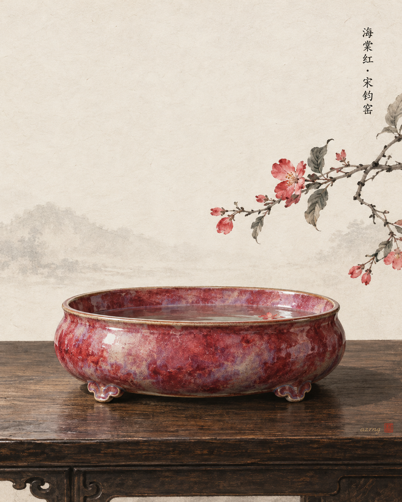
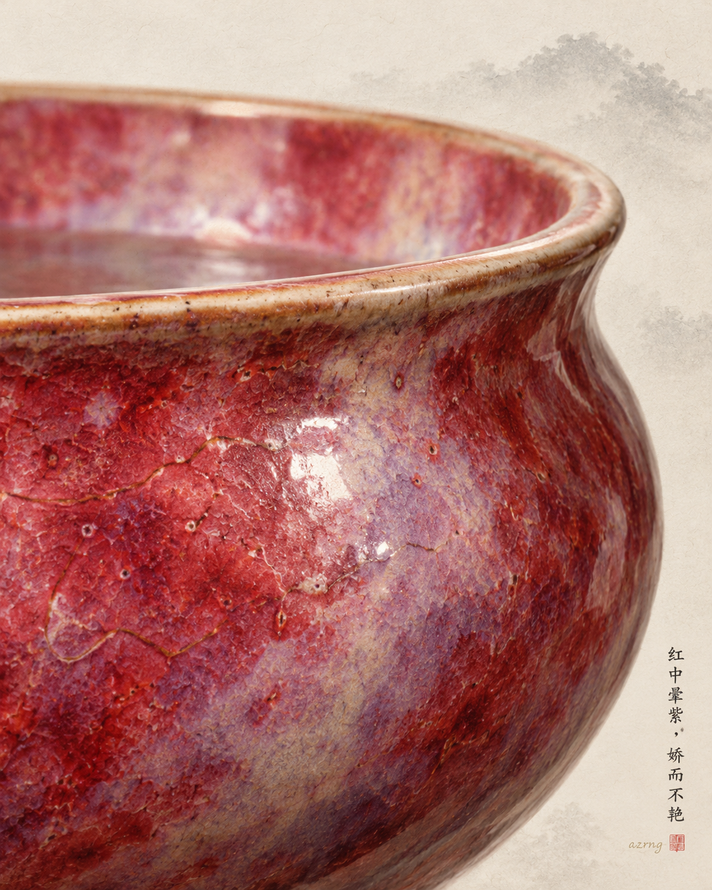
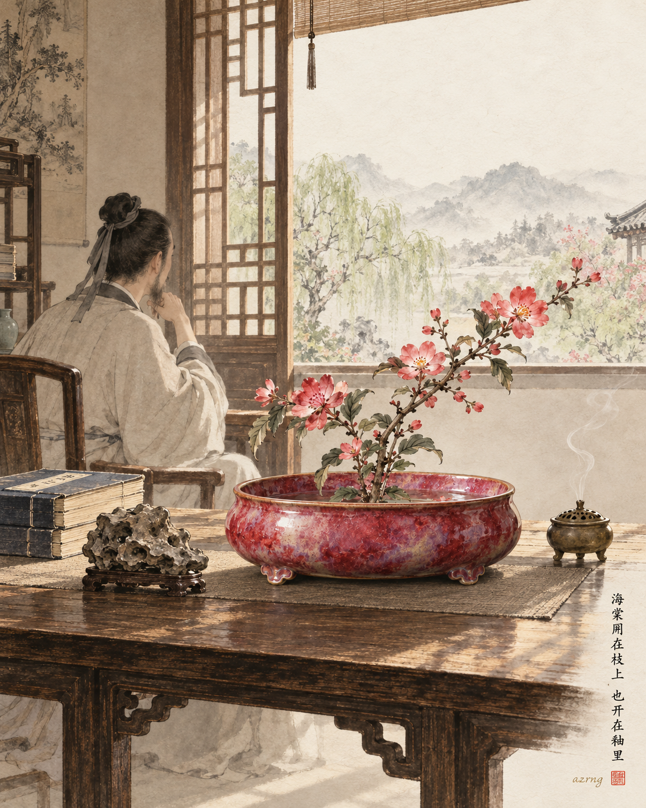

## 一色一诗

### 标题

《中国传统色｜海棠红 ×〈海棠〉｜故烧高烛照红妆》

### 正文

如果海棠红有出处，大概就在那个夜晚——苏东坡怕花睡去，特意点起高烛，照一照海棠的红妆。

海棠红，取自海棠花瓣，比正红多一分柔，比胭脂多一分暖。而苏轼笔下那株月下海棠，香雾空蒙，烛影摇红，恰好是这种颜色的样子：艳而不俗，暖中带静。

这次画了三张壁纸：

图一是完整诗境，月转回廊，高烛照花；

图二只留一枝海棠与一支红烛，是最浓的那抹海棠红；

图三画夜尽晓来，残烛落瓣，是惜花人散去之后的安静。

三张里，你更喜欢哪一种夜色？下一期想看哪一种传统色？

#中国传统色 #海棠红 #古诗词 #苏轼 #海棠 #国风壁纸 #东方美学 #手机壁纸

## 一色一源

### 标题

中国传统色｜海棠红：苏东坡熬夜也要看的颜色

### 正文

古人给颜色取名，有时候特别实在——像哪朵花，就叫哪个名。海棠红，就是海棠开到最盛时的那一抹颜色：比正红温柔，比粉色有底气，娇而不艳。

据说唐玄宗见宿醉初醒的杨贵妃，笑说她是“海棠睡未足”——从此这抹红里，又多了一点慵懒的美人气息。

它后来落进裙裾、口脂和诗里，成了古人春天最标准的红。每年海棠一开，古人的色卡和心情，就一起亮了。

如果让你给这抹红重新取个名字，你会叫它什么？

#中国传统色 #海棠红 #东方美学 #国风插画 #传统文化 #古人审美 #海棠花开 #国风美学

## 一色一物

### 标题

中国传统色｜海棠红，藏在宋代钧窑的一场窑变里

### 正文

海棠红，是红色里最像花的一种。

它不是正红的庄重，而是红中晕着微粉、透着一点紫的娇色——像春深时，海棠开到最盛的那一刻。

这一期，我选了宋代的钧窑。

钧窑在河南禹州，以窑变著称。铜在高温还原焰中翻涌幻化，出炉的釉色红紫相映，所以有“入窑一色，出窑万彩”的说法。清代《南窑笔记》记钧釉诸色，其中就有“海棠红”之名——窑工未必读过多少咏海棠的诗，但见到那一窑红，就知道该叫它什么。

何况红釉极难烧成，温度与火候差一点，红便沉了、飞了、灰了。所以海棠红不是调出来的，是等出来的。

它从来不是色卡上孤零零的一块颜色，它曾是火焰与瓷土的一场偶遇，真真切切活在中国人的窑火里。

下一期，你想看哪种颜色，藏在哪件古物里？

#中国传统色 #一色一物 #海棠红 #钧窑 #宋代美学 #东方美学 #瓷器 #国风美学