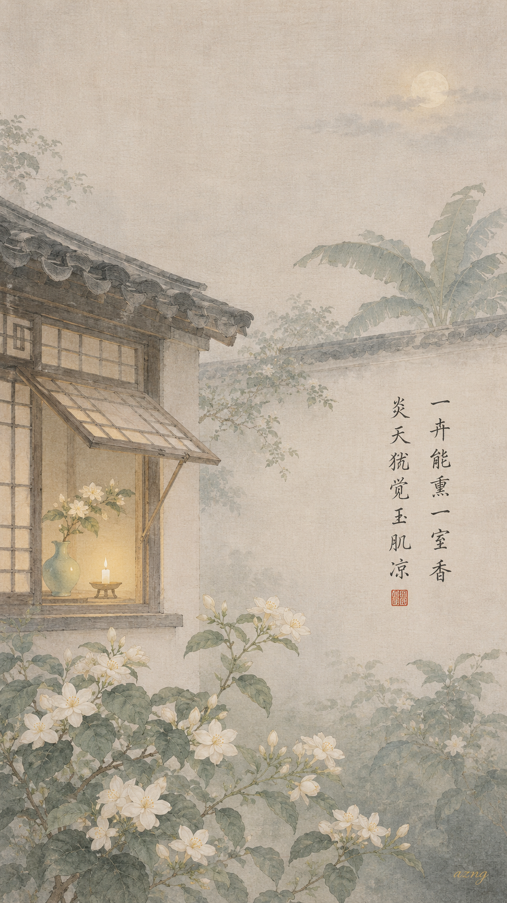
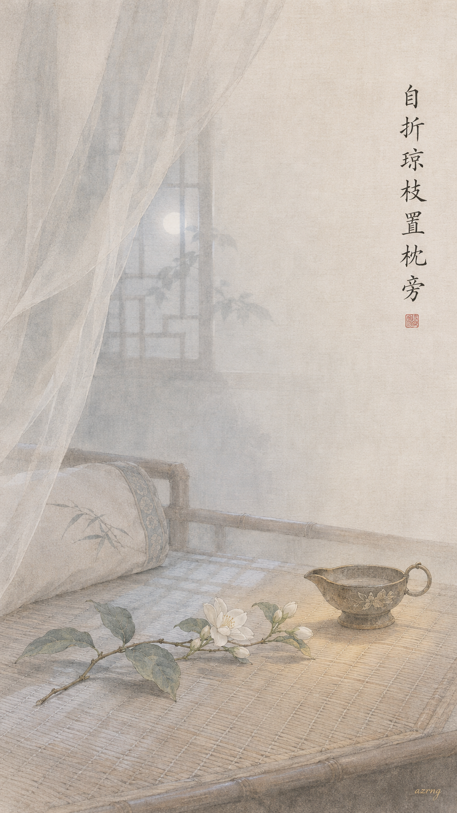
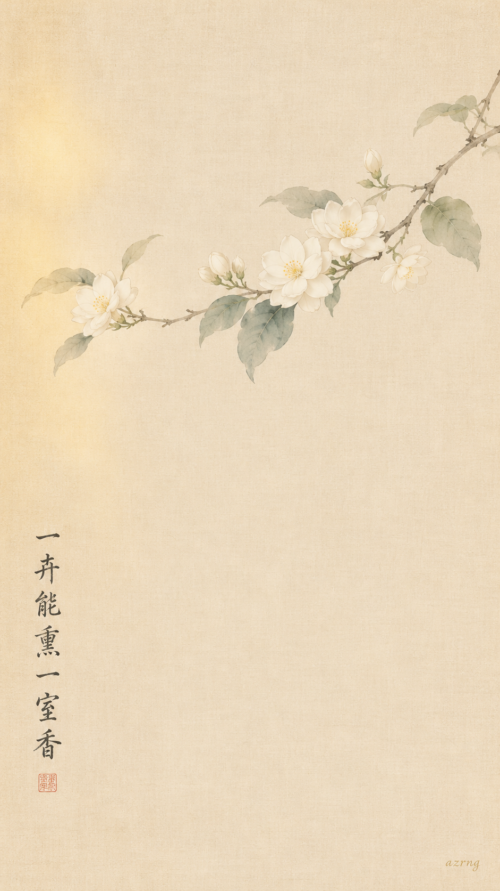
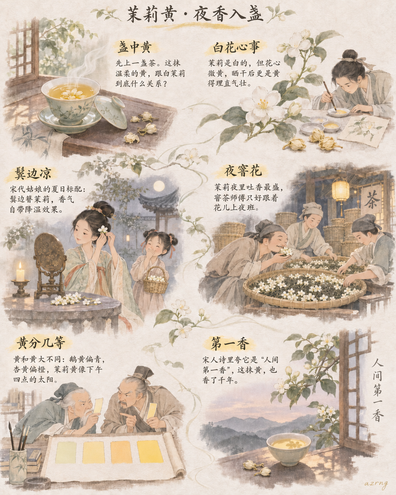
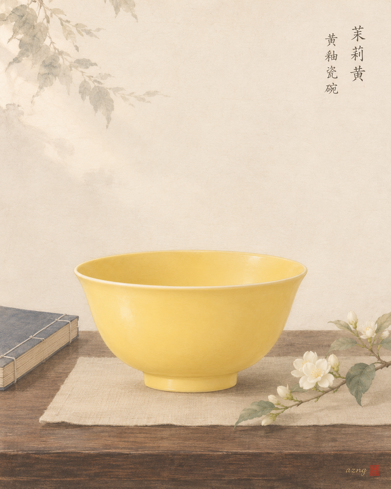
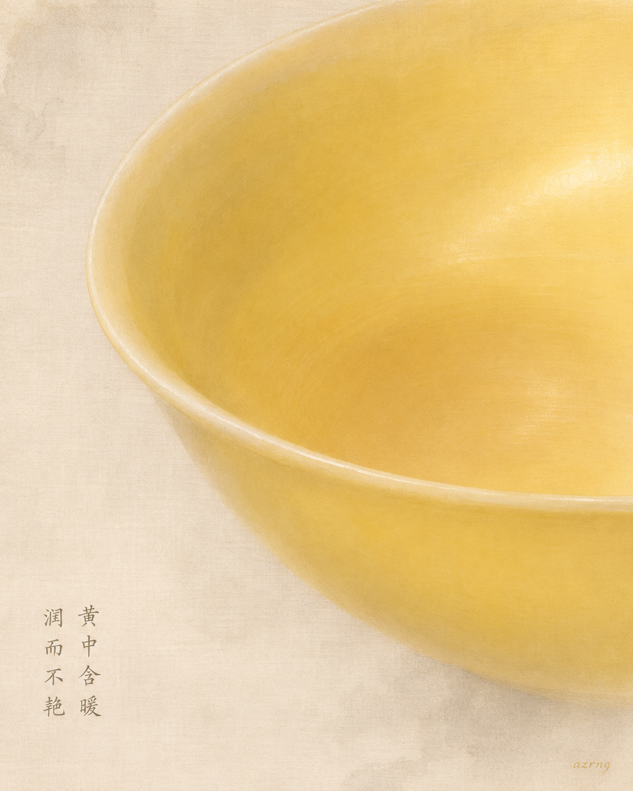
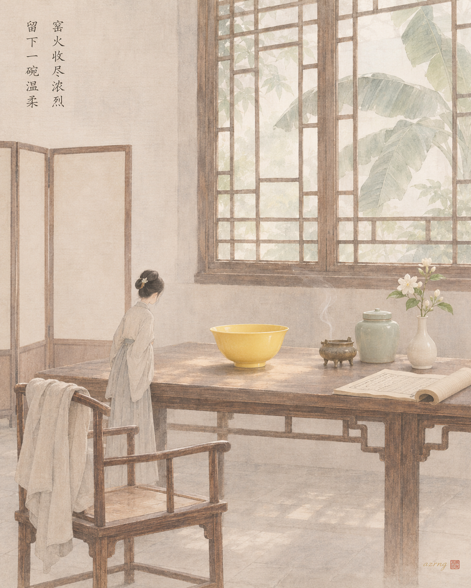

## 一色一诗

### 标题

中国传统色｜茉莉黄，落进南宋的夏夜

### 正文

炎天里的凉意，原来可以是一种颜色。

茉莉黄，介于月白与鹅黄之间，像茉莉花瓣在烛光边缘泛出的那一点暖。这一次，用它来配刘克庄的《茉莉》——“一卉能熏一室香，炎天犹觉玉肌凉”。一枝花，满室香，盛夏里竟生出肌肤般的清凉。这种暖里藏凉的微妙，正是茉莉黄的性情。

三张壁纸：图一画夏夜庭院，花影与烛光相映，是诗的完整场景；图二只取一枝茉莉，让颜色在留白里自己说话；图三折枝置枕畔，把诗的清凉延伸进一个无人的夜。

三张里，你更喜欢哪一种夏夜？
下一期，想看哪种中国传统色？

\#中国传统色 #茉莉黄 #古诗词 #国风壁纸 #手机壁纸 #东方美学 #宋画意境 #诗词里的夏天

## 一色一源

### 标题

中国传统色｜茉莉明明是白的，“茉莉黄”到底从哪来？

### 正文

今天这个颜色，听起来有点“名不副实”——茉莉花明明是白的，哪来的茉莉黄？

在现代中国传统色的整理体系里，茉莉黄（#F8DF72）是一种温柔明亮的浅暖黄：像刚冲开的茉莉花茶汤，也像晒干后蜷起来的茉莉花瓣。

茉莉本是漂洋过海来的“外来花客”，一般认为汉代前后才落户中国，结果一落地就火了两千年：宋代姑娘洗完澡，爱把茉莉簪在鬓边，图个清香沁凉；福州人干脆把它和茶坯放在一起，窨出了飘香至今的茉莉花茶，连宫廷里都独宠这一口。

白花藏黄，香里带甜——这就是茉莉黄。

那么问题来了：如果让你给这抹黄重新取个名字，你会叫它什么？评论区见～

\#中国传统色 #茉莉黄 #国风插画 #传统色科普 #东方美学 #茉莉花茶 #古人的浪漫 #颜色名字有多美

## 一色一物

### 标题

中国传统色｜茉莉黄，落在一只黄釉瓷碗里

### 正文

有些黄色，浓了便近威仪，淡了才见温柔。茉莉黄是后者，像茉莉花瓣尖上那一点薄薄的暖。

这一期，我选了一盏明代黄釉瓷碗。黄釉在明清两代身份特殊，是皇家牢牢握在手中的颜色；而碗身上那种柔和匀净的暖黄，与今天所说的茉莉黄，色调十分接近。

有趣的是，黄落在瓷上，从来不是“死”的颜色：釉厚处沉静，釉薄处透亮，迎光泛蜜，背光含蓄。它不是色卡上一格平面，而是会呼吸的黄。

所以茉莉黄并不只属于花，它也曾属于窑火、釉水，和案头的一碗人间烟火。

下一期，你想看哪一种颜色，藏在哪件古物里？

\#中国传统色 #一色一物 #茉莉黄 #黄釉瓷 #东方美学 #中国美学 #文物 #古代艺术

