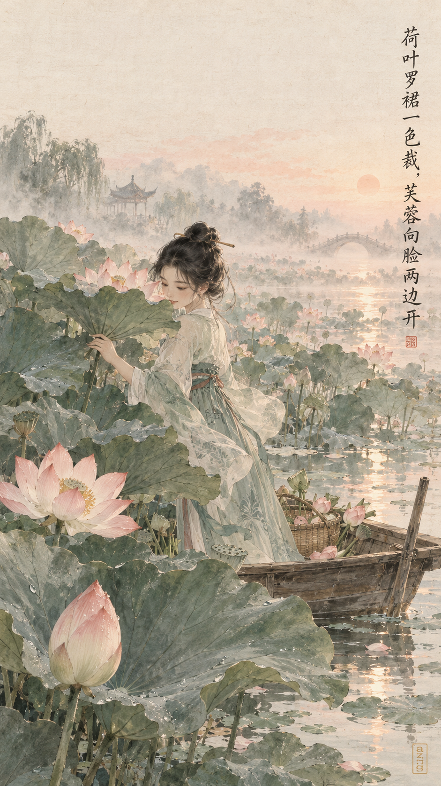
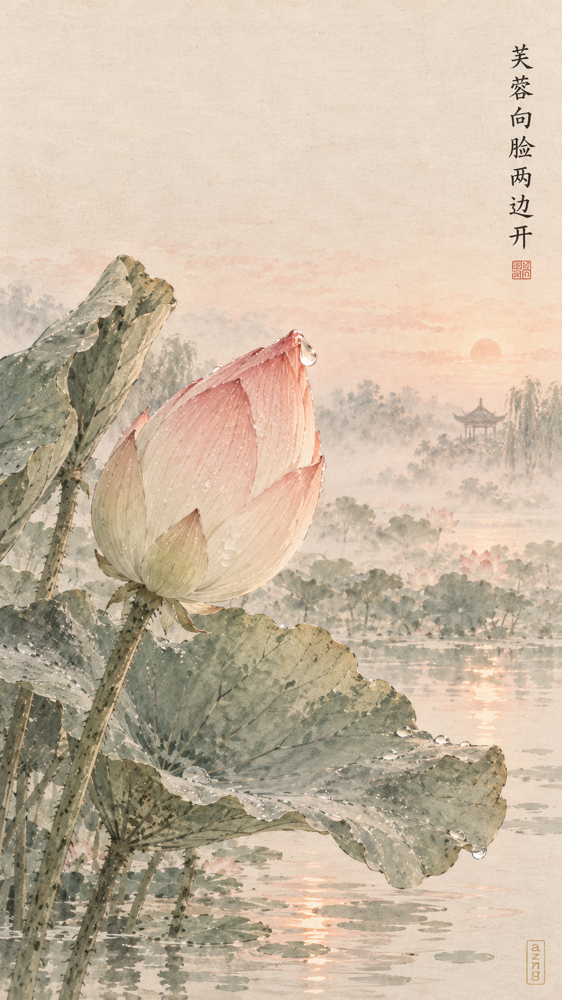
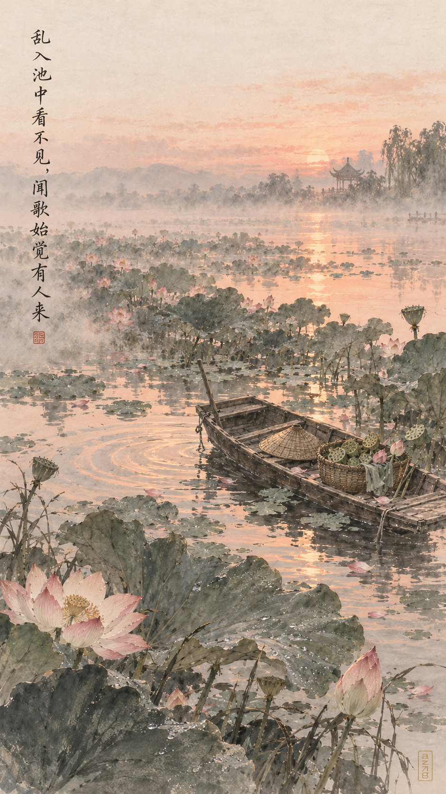
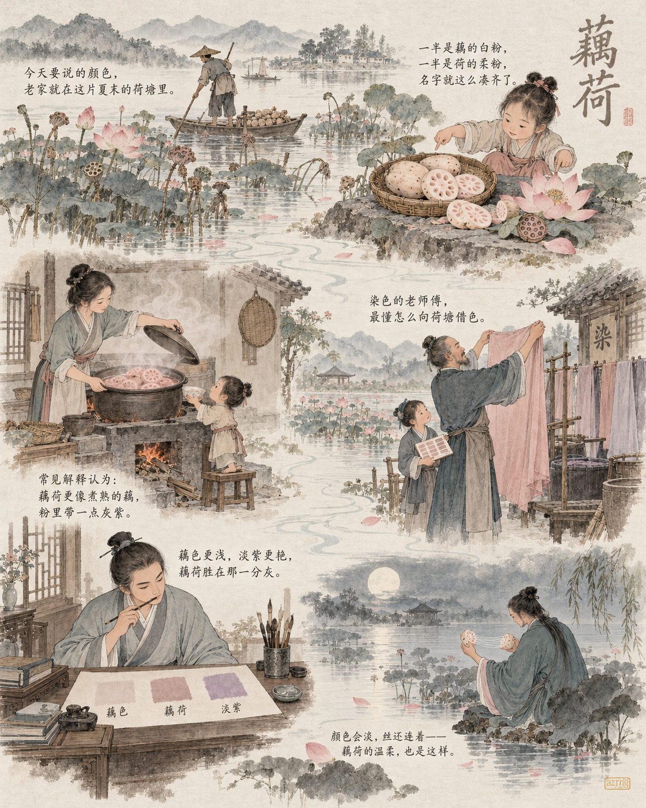
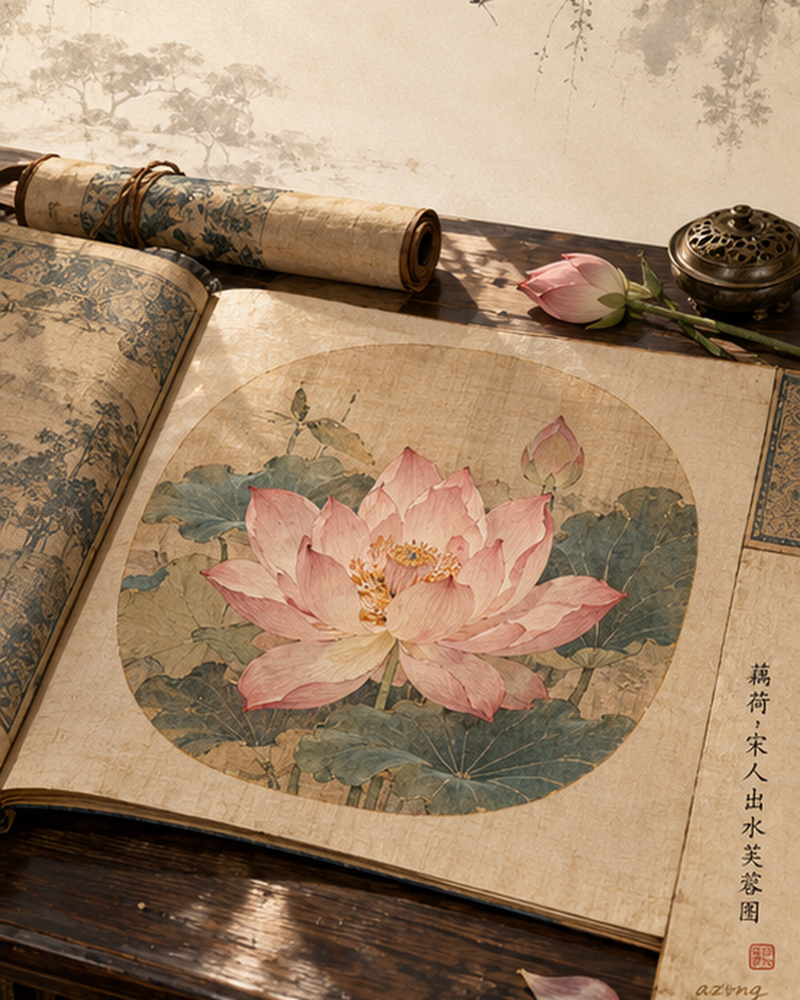
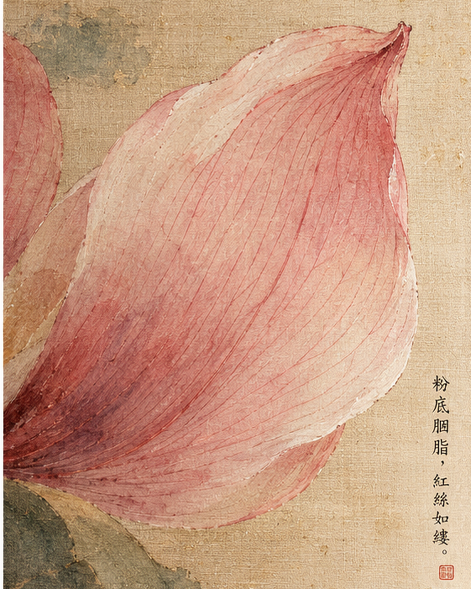
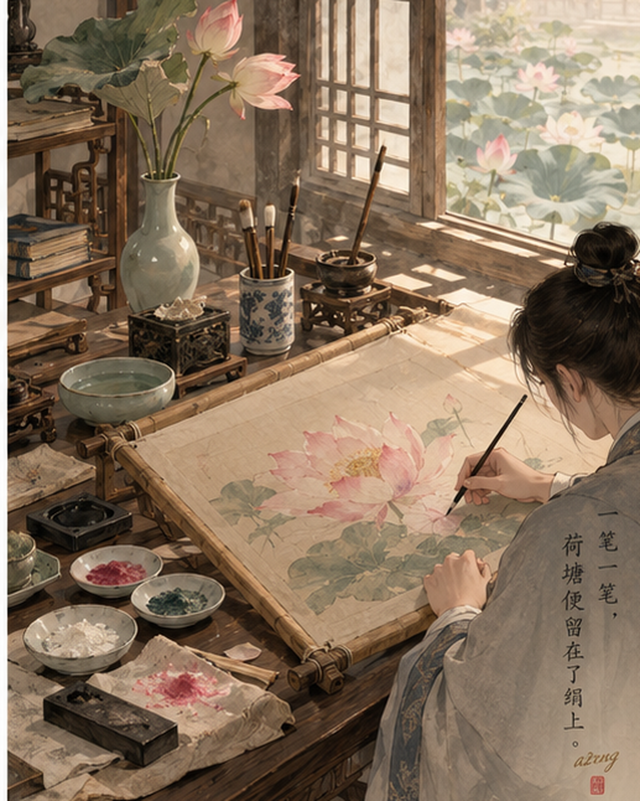

## 一色一诗

### 标题

（待补：颜色 × 诗题，格式参考《中国传统色｜朱红落进〈山行〉》）

### 正文

（待补：按 `doc/references/writing-style.md` 骨架撰写——开篇设问、中段展开、「三张壁纸」逐张说明、互动提问收尾）

\#中国传统色 #藕荷 #标签4 #标签5 #标签6 #标签7 #标签8 #标签9

## 一色一源

### 标题

（待补：颜色名 / 原料来源冷知识标题）

### 正文

（待补：来源冷知识，互动提问收尾；同一典故不得与其他栏目重复展开）

\#中国传统色 #藕荷 #标签4 #标签5 #标签6 #标签7 #标签8 #标签9

## 一色一物

### 标题

（待补：颜色落在一件实物上的标题）

### 正文

（待补：器物 / 织物展开，惯用「不是色卡上孤零零的一格」呼应句与「下一期，你想看哪种颜色…」收尾）

\#中国传统色 #一色一物 #藕荷 #标签5 #标签6 #标签7 #标签8 #标签9
