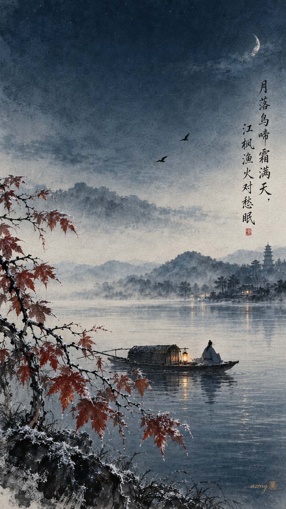
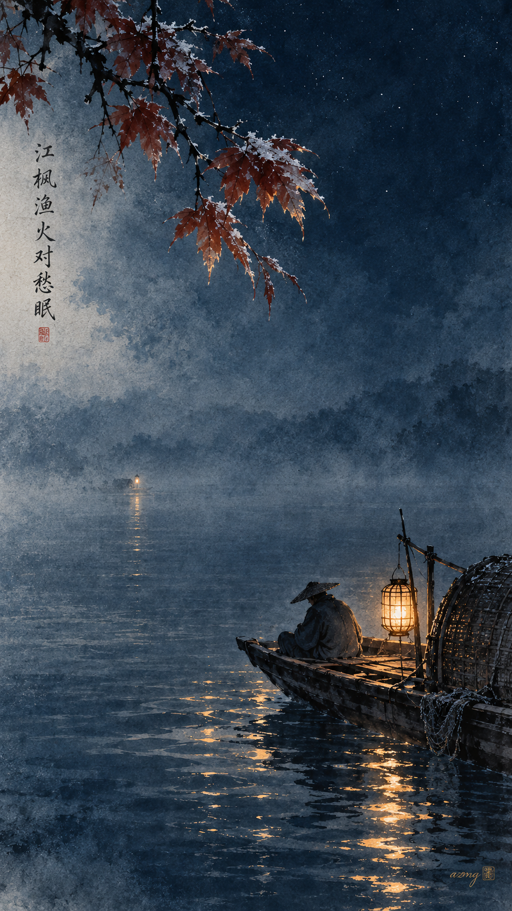
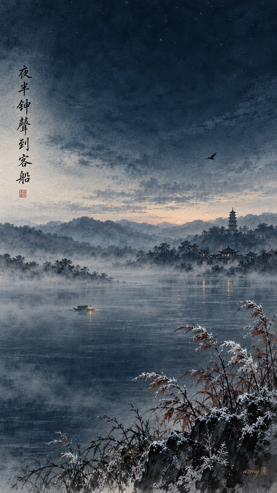
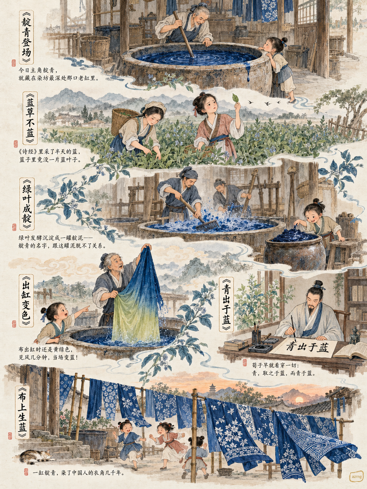
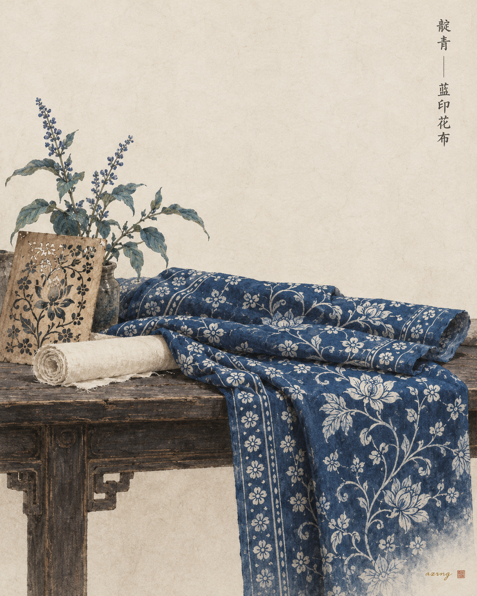
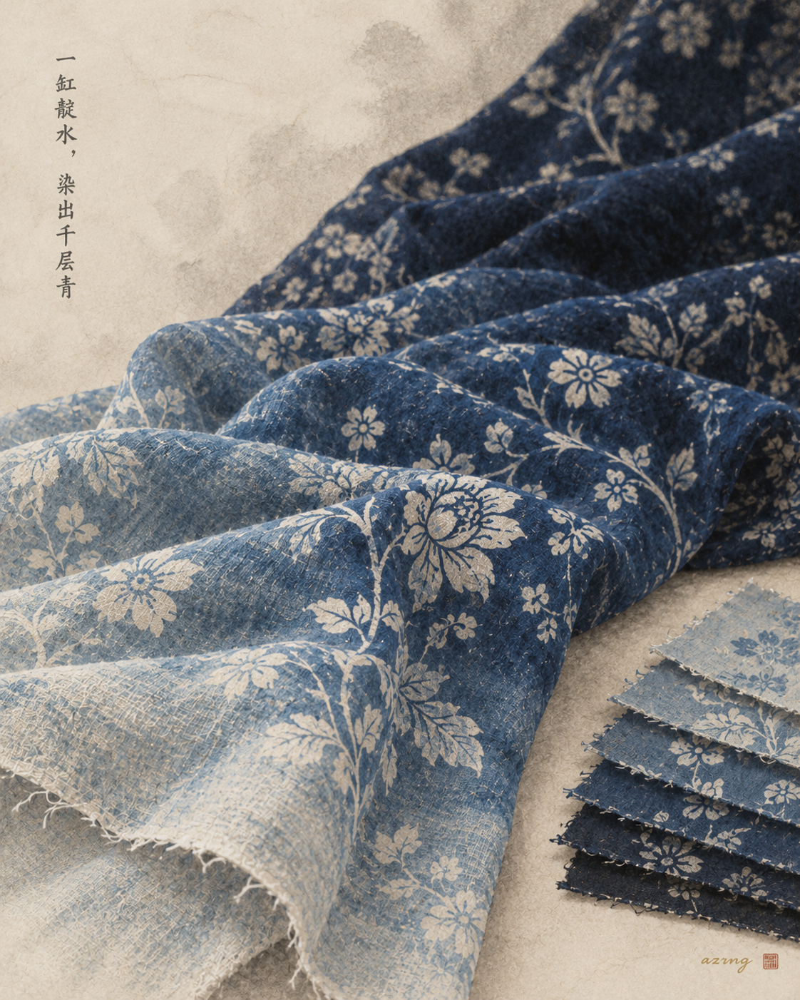
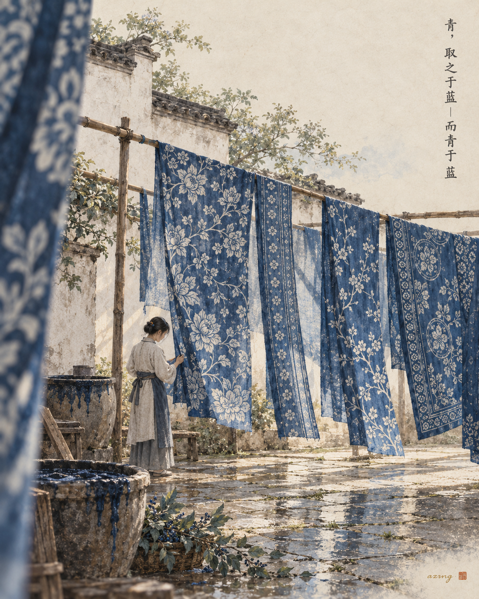

## 一色一诗

### 标题

中国传统色｜靛青 ×《枫桥夜泊》｜江枫渔火对愁眠

### 正文

如果《枫桥夜泊》有颜色，那一定是靛青——月亮落下去之后，天和水之间剩下的那一截深蓝。

靛青取自蓝草，比群青更沉，比墨色更醒。张继夜泊的那个晚上，霜气满天，渔火明灭，江水大概正是这种冷而安静的蓝。愁绪不喧哗，像靛青一样，是沉在水底的颜色。

三张壁纸，画的是这一夜的三个瞬间：图一是月落后的江岸全景，客舟泊在枫影与渔火之间；图二只取一点渔火，看它在靛青的江面上明明灭灭；图三循着夜半的钟声望向远处，天将亮未亮，愁绪也渐渐落定。

三张里，你更想停在哪一个瞬间？也可以告诉我，下一期想看哪种传统色。

#中国传统色 #靛青 #古诗词 #枫桥夜泊 #张继 #国风壁纸 #东方美学 #手机壁纸

## 一色一源

### 标题

中国传统色｜靛青：蓝草不蓝，“青出于蓝”原来是一句染色说明书

### 正文

如果要评古人最会“无中生有”的颜色，靛青一定进前三。

染它的蓝草，长得绿油油，一点不蓝。《诗经》里“终朝采蓝”，采的就是这把绿叶。可叶子入缸发酵、沉淀成靛泥之后，就成了流传千年的深蓝。

更妙的是出缸瞬间：布刚捞出来是黄绿色，见风几分钟，眼看着一点点变蓝——古人管这叫功夫，我们管这叫氧化。

《荀子》那句“青，取之于蓝，而青于蓝”，放在染坊里，简直就是现场解说。后来的蓝印花布，更是把它染进了日常。

如果让你用靛青染一样东西，你会染什么？

#中国传统色 #靛青 #青出于蓝 #蓝染 #蓝印花布 #国风插画 #东方美学 #古人的浪漫

## 一色一物

### 标题

中国传统色｜靛青，染在江南的蓝印花布里

### 正文

有些蓝，是种出来的。

蓝草入缸，发酵成靛，江南人把整个天空的深邃，都收进了一缸染液里。

本期的物，是蓝印花布。明清时期，它在江浙一带的市镇间盛行——以黄豆粉与石灰调成防染浆，透过镂花版刮在白布上，再入靛缸反复浸染，刮去浆的地方留白，其余处便沉成一片青蓝。

靛青最动人的地方，在于它的层次。布出缸时偏绿，遇到空气才渐渐转蓝，浸染一遍，颜色便加深一遍——从浅浅的月白之蓝，一直到近乎墨色的浓青。同一块布上，靛青从来不是一种颜色，而是无数层蓝的叠加。

《荀子》说：青，取之于蓝，而青于蓝。说的正是这件事——蓝草本身并不那么蓝，是人的手艺，让它青出于蓝。

所以靛青不是色卡上孤零零的一格，它曾晾晒在江南每一户人家的竹竿上。

下一期，你想看哪种颜色藏在哪件古物里？

#中国传统色 #一色一物 #靛青 #蓝印花布 #东方美学 #中国美学 #植物染 #非遗之美